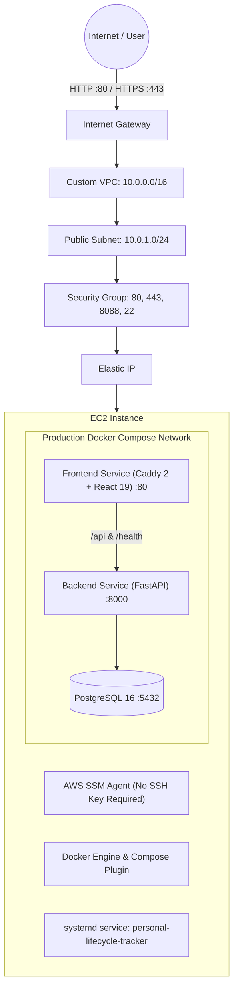

# Deploying Personal Lifecycle Tracker to AWS via Terraform

This guide covers deploying the **Personal Lifecycle Tracker** to Amazon Web Services (AWS) using **Terraform**.

The infrastructure is provisioned as a single cost-optimized, Free-Tier eligible Amazon EC2 instance running the production multi-container Docker Compose stack (`docker-compose.prod.yml`) with automated TLS and reverse proxying managed by Caddy 2.

---

## AWS Architecture Overview



### Key Architectural Features
1. **Free-Tier Eligible**: Runs on `t3.micro` or `t4g.micro` with 20 GB GP3 encrypted storage ($0/month under AWS Free Tier).
2. **Zero Open SSH Ports Needed**: Comes pre-configured with an IAM Role with `AmazonSSMManagedInstanceCore`. You can connect securely from the AWS Console or via `aws ssm start-session` without opening port 22 or managing PEM keys.
3. **Automated Docker Provisioning**: Cloud-init (`user_data.sh`) installs Docker Engine, clones the repo, configures production environment variables with random secure PostgreSQL passwords, and configures a systemd service for resilience across restarts.
4. **Static Elastic IP**: Automatically provisions and attaches an Elastic IP so the public address never changes on instance reboot.

---

## Prerequisites
1. An active [AWS Account](https://aws.amazon.com).
2. AWS Credentials configured (`~/.aws/credentials` or environment variables `AWS_ACCESS_KEY_ID`, `AWS_SECRET_ACCESS_KEY`, `AWS_DEFAULT_REGION`).
3. Docker installed on your host machine (no Terraform CLI needed).

---

## Step-by-Step Deployment Instructions

### 1. Configure Variables
Copy the example variables file:
```bash
cp terraform/aws/terraform.tfvars.example terraform/aws/terraform.tfvars
```

Edit `terraform/aws/terraform.tfvars` according to your preferences:
```hcl
aws_region        = "us-east-1"
project_name      = "personal-lifecycle-tracker"
environment       = "production"
instance_type     = "t3.micro"
app_port          = 80
allowed_http_cidr = "0.0.0.0/0"
repo_url          = "https://github.com/pithwamanish/personal-lifecycle-tracker.git"
repo_branch       = "main"
```

### 2. Initialize and Validate
Run containerized Terraform commands via Makefile:
```bash
# Initialize providers and modules
make tf-init-aws

# Validate configuration syntax
make tf-validate-aws
```

### 3. Generate Execution Plan
Run Terraform plan to preview the resources that will be created:
```bash
make tf-plan-aws
```

### 4. Apply and Provision Infrastructure
Run Terraform apply using your AWS credentials:
```bash
docker run --rm -it \
  -v $(PWD)/terraform/aws:/workspace \
  -w /workspace \
  -v $HOME/.aws:/root/.aws:ro \
  -e AWS_PROFILE=${AWS_PROFILE:-default} \
  hashicorp/terraform:1.7.5 apply
```

Type `yes` when prompted. Provisioning the VPC, Security Group, and EC2 instance takes approximately 1–2 minutes.

---

## Verifying Deployment

Once `terraform apply` finishes, it outputs:
```text
Outputs:

application_url = "http://54.210.xx.xx"
healthcheck_url = "http://54.210.xx.xx/health"
instance_id = "i-0abcd1234ef56789"
public_ip = "54.210.xx.xx"
ssm_session_command = "aws ssm start-session --target i-0abcd1234ef56789 --region us-east-1"
```

1. **Verify Health**:
   ```bash
   curl -f http://<public_ip>/health
   # Response: {"status":"healthy","database":"connected","version":"1.0.0"}
   ```
2. **Access Web Application**:
   Open `http://<public_ip>` in your web browser.
3. **Connect to Server Shell via SSM (No SSH key needed)**:
   ```bash
   aws ssm start-session --target <instance_id> --region us-east-1
   ```
4. **Inspect Container Status on Server**:
   ```bash
   sudo docker compose -f /opt/personal-lifecycle-tracker/docker-compose.prod.yml ps
   ```

---

## Teardown & Clean Up
To destroy all provisioned AWS resources and eliminate any ongoing charges:
```bash
docker run --rm -it \
  -v $(PWD)/terraform/aws:/workspace \
  -w /workspace \
  -v $HOME/.aws:/root/.aws:ro \
  -e AWS_PROFILE=${AWS_PROFILE:-default} \
  hashicorp/terraform:1.7.5 destroy
```
