# CI/CD Pipeline & Automated Render Deployment Guide

This guide details the continuous integration and continuous deployment (CI/CD) pipeline for the **Personal Lifecycle Tracker** implemented via GitHub Actions ([`.github/workflows/ci.yml`](../../.github/workflows/ci.yml)).

---

## 1. Pipeline Architecture

```mermaid
flowchart TD
    subgraph Trigger["Pipeline Triggers"]
        PR["Pull Request to main or dev"]
        PushDev["Push to dev / develop -> Build & Deploy Dev"]
        PushMain["Push to main -> Build & Deploy Production"]
        Dispatch["Workflow Dispatch (Select Env: dev / production)"]
    end

    subgraph ParallelTests["Phase 1: Parallel Unit & Contract Tests"]
        direction LR
        BackendJob["test-backend\n- Backend Container Build\n- FastAPI Pytest Suite\n- SQLite In-Memory Isolation"]
        FrontendJob["test-frontend\n- Frontend Container Build\n- TypeScript Static Typecheck\n- Vitest Component & Unit Tests"]
    end

    subgraph ComposeStack["Phase 2: Docker Compose Integration & E2E"]
        direction TB
        BuildStack["docker compose build"]
        StartStack["docker compose up -d (db, backend, frontend)"]
        WaitHealth["Wait for Backend Healthcheck :8003/health"]
        IntegTests["PostgreSQL Integration Tests (Pytest)"]
        E2ETests["Playwright E2E Tests (17 User Journeys)"]
        TearDown["docker compose down -v"]

        BuildStack --> StartStack --> WaitHealth --> IntegTests --> E2ETests --> TearDown
    end

    subgraph BuildStage["Phase 3: Build & Push to Registry (ECR)"]
        direction TB
        ResolveEnv["Resolve TARGET_ENV\n(main -> production, dev -> dev)"]
        GenTag["Generate Pattern Tag:\nYYYYMMDD-HHMMSS-shortsha\n(e.g. 20260818-163457-83242da)"]
        AuthECR["OIDC Auth & ECR Login"]
        BuildImgs["Build Backend (FastAPI) & Frontend (Caddy) Images"]
        PushECR["Push Images to Amazon ECR\n(:tag, :target-latest, :latest)"]
        RecordSSM["Record Image Tag in SSM Parameter Store\n(/personal-lifecycle/dev/image_tag)"]

        ResolveEnv --> GenTag --> AuthECR --> BuildImgs --> PushECR --> RecordSSM
    end

    subgraph DeployStage["Phase 4: Deploy & Serve from Registry"]
        direction TB
        PullImgs["Pull Image from Registry (ECR)\n(Zero Host Build)"]
        ServeStack["Serve Application via Docker Compose / VM\n(docker compose up -d --no-build)"]
        TriggerRender["Trigger Render Deployment (Optional Hook/API)"]
        ValidateHealth["Poll & Validate Environment Health Endpoint\n(Dev or Prod Frontend :80/health)"]

        PullImgs --> ServeStack --> TriggerRender --> ValidateHealth
    end

    Trigger --> ParallelTests
    BackendJob --> ComposeStack
    FrontendJob --> ComposeStack
    ComposeStack --> BuildStage
    BuildStage --> DeployStage
```



---

## 2. Key Architectural Invariants

### A. Parallel Test Execution
To optimize feedback loops and token consumption:
- The **Backend Unit Test Job** (`test-backend`) and **Frontend Unit Test Job** (`test-frontend`) run simultaneously in parallel without interdependencies.
- Unit tests use zero host dependencies: both execute strictly inside Docker containers via `docker compose run --rm --no-deps`.

### B. Full Docker Compose Stack Verification
- Integration tests require a live, running database and API stack.
- The `integration-and-e2e` job starts the complete Compose topology (`db`, `backend`, `frontend`), waits for the backend `/health` endpoint to report HTTP 200, and sequentially executes:
  1. **PostgreSQL Integration Tests** (`backend/tests/integration/`): 27 end-to-end integration workflows covering authentication, cascades, group collaboration, and daily digest generation.
  2. **Playwright E2E Tests** (`e2e/`): 17 browser tests verifying complete user flows in headless Chromium.

### C. Keyless Cloud Authentication (GitHub OIDC)
- In compliance with enterprise security standards, static, long-lived deployment credentials are never hardcoded in GitHub Actions.
- GitHub Actions mints an OpenID Connect (OIDC) JWT token (`id-token: write`).
- The pipeline authenticates against AWS STS using `aws-actions/configure-aws-credentials@v4` with a least-privilege IAM role.
- Once authenticated, the job retrieves the Render deployment hook or API token dynamically from **AWS Secrets Manager** (`personal-lifecycle/render`) or **AWS SSM Parameter Store**.
- Fallback support is provided for direct GitHub repository secrets if operating outside AWS IAM.

### D. Automated Health Endpoint Validation
- Triggering a deployment is only half the release contract: the pipeline must verify that the deployed service actually boots, connects to the database, and serves traffic.
- The pipeline enters a resilient polling loop querying the live healthcheck endpoint (e.g., `http://localhost:8088/health` or live URL):
  - Checks every 10 seconds for up to 30 attempts (5 minutes).
  - Verifies HTTP 200 OK status code.
  - Inspects the JSON body to verify `"status": "healthy"` and database connectivity.
  - Fails the build if the health endpoint fails to stabilize within the threshold.

### E. Two-Stage Build & Deploy (ECR Registry Integration)
To eliminate redundant compilation on production hosts and ensure 100% artifact reproducibility:
1. **Split into Two Independent Stages**:
   - **Build Stage (`build-and-push-ecr`)**: Compiles backend (`./backend`) and frontend (`./frontend`) Docker images once, assigns deterministic tags, and pushes artifacts to Amazon ECR.
   - **Deploy Stage (`deploy`)**: Pulls pre-built images directly from Amazon ECR and serves them via Docker Compose (`docker compose -f docker-compose.prod.yml up -d --no-build`), completely eliminating image builds during the deployment phase.
2. **Deterministic Timestamp-ShortSHA Image Tagging**:
   - Every image is tagged using the exact `YYYYMMDD-HHMMSS-shortsha` pattern:
     ```bash
     TAG="$(date -u +'%Y%m%d-%H%M%S')-$(git rev-parse --short=7 HEAD)"
     # Example: 20260818-163457-83242da
     ```
   - In addition to the immutable timestamp tag, images are also tagged with `${TARGET_ENV}-latest` and `latest`.
   - The deployed image tag is persisted to AWS SSM Parameter Store (`/personal-lifecycle/${TARGET_ENV}/image_tag`) for automated discovery by downstream promotion workflows.


---

## 3. GitHub Secrets Configuration Matrix

Configure these secrets under **Settings > Secrets and variables > Actions** in your GitHub repository:

| Secret Name | Required? | Purpose | Example Value |
|---|---|---|---|
| `RENDER_OIDC_ROLE_ARN` | Recommended | AWS IAM Role ARN assumed via GitHub Actions OIDC | `arn:aws:iam::123456789012:role/personal-lifecycle-tracker-github-oidc-render-deployer-production` |
| `AWS_ROLE_TO_ASSUME` | Optional | Alternative alias for the OIDC IAM role ARN | `arn:aws:iam::123456789012:role/...` |
| `AWS_REGION` | Optional | AWS Region where secrets are stored | `us-east-1` (default) |
| `RENDER_DEPLOY_HOOK_URL` | Optional | Render 1-click Deploy Hook URL (direct fallback) | `https://api.render.com/deploy/srv-c1234567890abcdef?key=secretkey` |
| `RENDER_API_KEY` | Optional | Render API Key for REST API deployment | `rnd_abcdef1234567890` |
| `RENDER_SERVICE_ID` | Optional | Render Service ID targeted for deployment | `srv-c1234567890abcdef` |
| `RENDER_HEALTH_URL` | Optional | Custom live healthcheck URL to validate | `https://<your-service-name>.onrender.com/health` |
| `STRICT_HEALTH_CHECK` | Optional | Enforce pipeline failure on healthcheck timeout (`true` / `false`) | `true` (default: `true`) |

---

## 4. Provisioning the GitHub OIDC Role via Terraform

The repository includes a ready-to-use Terraform module ([`terraform/aws/oidc.tf`](../../terraform/aws/oidc.tf)) that creates:
1. The **GitHub OIDC Identity Provider** (`token.actions.githubusercontent.com`).
2. The **IAM Role** scoped strictly to your GitHub repository with `sts:AssumeRoleWithWebIdentity`.
3. An **IAM Policy** granting access to `personal-lifecycle/render` in Secrets Manager and SSM.

### Steps to Provision:

1. Edit `terraform/aws/terraform.tfvars`:
   ```hcl
   enable_github_oidc = true
   github_repo        = "your-username/your-repo-name"
   ```

2. Validate and apply inside Docker:
   ```bash
   make tf-validate-aws
   make tf-plan-aws
   ```

3. Note the output `github_oidc_role_arn`:
   ```text
   github_oidc_role_arn = "arn:aws:iam::123456789012:role/personal-lifecycle-tracker-github-oidc-render-deployer-production"
   ```

4. Store your Render deploy credentials in AWS Secrets Manager:
   ```bash
   aws secretsmanager create-secret \
     --name personal-lifecycle/render \
     --secret-string '{"deploy_hook_url":"https://api.render.com/deploy/srv-xxx?key=yyy"}'
   ```

---

## 5. Local Validation with `act`

You can validate the pipeline syntax and test jobs locally before pushing:

```bash
# Validate workflow syntax with dry run
rtk act -n -W .github/workflows/ci.yml

# Run backend test job locally
rtk act -j test-backend -W .github/workflows/ci.yml

# Run frontend test job locally
rtk act -j test-frontend -W .github/workflows/ci.yml
```

---

## 6. End-to-End Verification Checklist

- [x] Backend and Frontend unit tests execute in parallel.
- [x] Docker Compose stack builds cleanly without host tools.
- [x] Integration tests pass against PostgreSQL 16 container.
- [x] Playwright E2E suite passes all 17 user journeys.
- [x] GitHub OIDC role assumption exchanges temporary credentials without static keys.
- [x] Render deployment triggered via Deploy Hook or REST API.
- [x] Health check polling loop validates live HTTP 200 and `"status": "healthy"`.

---

## 7. Dev to Production Manual Promotion Workflow (`promote-dev-to-prod.yml`)

The repository includes a dedicated manual promotion workflow ([`.github/workflows/promote-dev-to-prod.yml`](../../.github/workflows/promote-dev-to-prod.yml)) designed to promote verified development versions from `dev` to the production branch (`main`), cut semantic release tags, compile release notes, and deploy directly to the production Render environment.

### A. Promotion Workflow Architecture

```mermaid
flowchart TD
    Operator["Operator\n(workflow_dispatch)"] --> Inputs["Inputs:\n- source_branch (dev)\n- target_branch (main)\n- version_tag (optional)\n- deploy_to_production (bool)\n- dry_run (bool)"]

    subgraph Phase1["Phase 1: Pre-Flight Validation & Quality Gates"]
        direction TB
        BranchVerify["Verify Remote Branches Exist & Fetch"]
        CommitCount["Count Commits Ahead & Extract Diff"]
        MergeConflictCheck["Simulate Merge (Zero Conflict Validation)"]
        TestGates["Containerized Test Gates:\n- Backend Unit Tests (Pytest)\n- Frontend Lint & Vitest\n- PostgreSQL Integration Tests"]

        BranchVerify --> CommitCount --> MergeConflictCheck --> TestGates
    end

    subgraph Phase2["Phase 2: Promotion, SemVer & Release"]
        direction TB
        ResolveTag["Resolve Version Tag (Auto SemVer / Custom Tag)"]
        ExecMerge["Merge dev -> main (--no-ff with Release Metadata)"]
        GitTag["Create Annotated Tag (vX.Y.Z)"]
        GitPush["Push main Branch & Tag to Remote"]
        GHRelease["Create GitHub Release with Changelog Notes"]

        ResolveTag --> ExecMerge --> GitTag --> GitPush --> GHRelease
    end

    subgraph Phase3["Phase 3: Dev Image Promotion to Prod & Serve"]
        direction TB
        OIDCAuth["Keyless OIDC Auth (AWS STS / ECR Login)"]
        PullDevImg["Pull Currently Deployed Dev Image from ECR\n(Discovered via SSM /personal-lifecycle/dev/image_tag)"]
        TagProd["Tag Image with Pattern:\nYYYYMMDD-HHMMSS-shortsha\n(e.g. 20260818-163457-83242da) & vX.Y.Z"]
        PushProdECR["Push Promoted Images to Amazon ECR\n(:prod_tag, :vX.Y.Z, :prod-latest)"]
        ServeProd["Serve Promoted Containers on Production\n(docker compose -f docker-compose.prod.yml up -d --no-build)"]
        PollProdHealth["Poll Live Health Endpoint (30 attempts / 10s intervals)\nValidate HTTP 200 & 'status: healthy'"]

        OIDCAuth --> PullDevImg --> TagProd --> PushProdECR --> ServeProd --> PollProdHealth
    end

    Inputs --> Phase1
    Phase1 --> Phase2
    Phase2 --> Phase3
```



### B. Workflow Dispatch Inputs Reference

| Input | Type | Default | Description |
|---|---|---|---|
| `source_branch` | `string` | `dev` | Source development branch containing verified commits to promote. |
| `target_branch` | `string` | `main` | Target production branch receiving the release merge. |
| `version_tag` | `string` | `""` | Specific release tag (e.g. `v1.1.0`). If left blank, the workflow automatically increments the patch version from the latest tag (e.g., `v1.0.0` → `v1.0.1`). |
| `release_title` | `string` | `""` | Custom GitHub Release title (defaults to `Production Release <version>`). |
| `deploy_to_production` | `boolean` | `true` | Immediately deploys promoted dev images to the Production environment. |
| `dev_image_tag` | `string` | `""` | Specific dev ECR image tag to promote (leave blank to auto-detect currently deployed dev image via SSM). |
| `skip_tests` | `boolean` | `false` | Bypasses automated test gates before promotion (**strongly discouraged** for production releases). |
| `dry_run` | `boolean` | `false` | Simulates branch merge, test execution, tag calculation, and changelog generation without pushing to remote or triggering production deployment. |

### C. Execution Safeguards

1. **Strict Concurrency Lock**:
   - Uses `concurrency: group: production-promotion` with `cancel-in-progress: false` to prevent multiple operators from triggering overlapping promotion merges.
2. **Pre-Merge Conflict Detection**:
   - Before executing any branch changes or test suites, the workflow runs a simulated merge in a detached branch. If any merge conflicts exist between `dev` and `main`, the workflow halts immediately with an actionable error.
3. **Automated SemVer Patch Calculation**:
   - If no explicit `version_tag` is supplied, the workflow queries `git tag -l "v*" --sort=-v:refname` and calculates the next semantic patch version automatically (or seeds `v1.0.0`).
4. **Rich Step Summaries**:
   - Both validation, promotion, and deployment stages output formatted Markdown summaries directly to `$GITHUB_STEP_SUMMARY` detailing commit SHAs, author metadata, changelog entries, and live endpoint response codes.

### D. How to Trigger via GitHub CLI or Web UI

**Via GitHub Web UI**:
1. Navigate to **Actions > Promote Dev to Production**.
2. Click **Run workflow**.
3. Select `source_branch: dev`, `target_branch: main`, and optionally provide a `version_tag`.
4. Click **Run workflow**.

**Via GitHub CLI (`gh`)**:
```bash
# Run promotion in dry-run mode (simulation only)
gh workflow run promote-dev-to-prod.yml -f source_branch=dev -f dry_run=true

# Run full live promotion to production with auto-incremented SemVer
gh workflow run promote-dev-to-prod.yml -f source_branch=dev -f target_branch=main

# Run promotion with a specific version tag and custom release title
gh workflow run promote-dev-to-prod.yml \
  -f source_branch=dev \
  -f target_branch=main \
  -f version_tag=v1.1.0 \
  -f release_title="Production Release v1.1.0 (Q4 Feature Milestone)"
```
