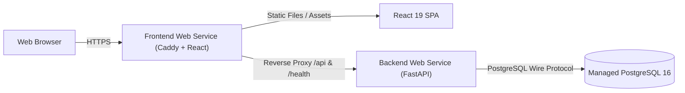

# Deploying Personal Lifecycle Tracker to Render

[Render](https://render.com) is a modern cloud Application Platform-as-a-Service (PaaS). This guide details two automated ways to deploy the Personal Lifecycle Tracker:
1. **Option A (Recommended)**: Render Blueprint (`render.yaml`) — 1-click declarative Git deployment.
2. **Option B**: Terraform (`terraform/render/`) — Infrastructure as Code management using the Render Terraform Provider.

---

## Architecture on Render



- **Frontend**: Docker Web Service running Caddy 2 (`caddy:2-alpine`), serving the React 19 production build and reverse-proxying `/api/*` and `/health` requests to the backend service.
- **Backend**: Docker Web Service running FastAPI & Uvicorn (`python:3.11-slim`), connected to the managed PostgreSQL database.
- **Database**: Render Managed PostgreSQL (version 16), automatically provisioned and managed.

---

## Option A: 1-Click Render Blueprint (`render.yaml`)

### Prerequisites
1. A [Render account](https://dashboard.render.com).
2. The Git repository pushed to GitHub or GitLab.

### Step-by-Step Instructions

1. **Push your code to GitHub / GitLab**:
   Ensure [`render.yaml`](file:///home/manish/AI-Practice/DataTalks/ai-dev-tools-zoomcamp-2026/project/personal-lifecycle-tracker/render.yaml) is present in the repository root.

2. **Create New Blueprint Instance in Render**:
   - Go to the [Render Dashboard](https://dashboard.render.com).
   - Click the **"New +"** button in the top navigation bar.
   - Select **"Blueprint"**.
   - Connect your GitHub repository (`personal-lifecycle-tracker`).
   - Render will automatically parse `render.yaml` and show the 3 resources to be provisioned:
     - `personal-lifecycle-db` (PostgreSQL Database)
     - `personal-lifecycle-backend` (Docker Web Service)
     - `personal-lifecycle-frontend` (Docker Web Service)

3. **Apply & Deploy**:
   - Click **"Apply"**.
   - Render will provision the database, build the backend Docker container, build the frontend Caddy container, and start the services.
   - Once deployment completes (usually 2–3 minutes), click on the `personal-lifecycle-frontend` service to view its live `.onrender.com` URL.

4. **Verify Deployment**:
   - Test Healthcheck: `https://<frontend-subdomain>.onrender.com/health`
   - Test Web App: Open `https://<frontend-subdomain>.onrender.com/` in your browser.
   - Test API Docs: `https://<backend-subdomain>.onrender.com/docs`

---

## Option B: Deploying via Terraform (`terraform/render/`)

If your team manages infrastructure via Terraform, you can use the official Render Terraform provider.

### Prerequisites
1. Generate a Render API Key:
   - Log into [Render Dashboard](https://dashboard.render.com).
   - Go to **Account Settings** -> **API Keys** -> **Create API Key**.
2. Retrieve your Render Owner/Workspace ID:
   - Visible in your URL or workspace settings (starts with `usr-` or `tea-`).

### Step-by-Step Instructions

1. **Configure Variables**:
   Copy the example variables file:
   ```bash
   cp terraform/render/terraform.tfvars.example terraform/render/terraform.tfvars
   ```
   Edit `terraform/render/terraform.tfvars` with your credentials:
   ```hcl
   render_api_key  = "rnd_your_actual_api_key"
   render_owner_id = "tea_your_actual_owner_id"
   environment     = "production"
   region          = "oregon"
   repo_url        = "https://github.com/your-org/personal-lifecycle-tracker.git"
   repo_branch     = "main"
   ```

2. **Initialize and Validate (Zero Host Runtime)**:
   ```bash
   make tf-init-render
   make tf-validate-render
   ```

3. **Plan Infrastructure**:
   ```bash
   make tf-plan-render
   ```

4. **Apply Deployment**:
   ```bash
   docker run --rm -it \
     -v $(PWD)/terraform/render:/workspace \
     -w /workspace \
     -e RENDER_API_KEY="rnd_your_actual_api_key" \
     hashicorp/terraform:1.7.5 apply
   ```

5. **Outputs**:
   Terraform will display:
   - `backend_url`
   - `frontend_url`
   - `application_health_url`

---

## Environment Variables & Configuration

| Service | Variable | Purpose | Value Source |
|---|---|---|---|
| **Backend** | `PORT` | Listening HTTP port | `8000` |
| **Backend** | `DATABASE_URL` | PostgreSQL connection string | Injected from `personal-lifecycle-db` |
| **Backend** | `PYTHONUNBUFFERED` | Immediate stdout streaming | `1` |
| **Backend** | `CORS_ORIGINS` | Permitted browser origins | `*` |
| **Frontend** | `PORT` | Caddy listening port | `80` |
| **Frontend** | `BACKEND_URL` | Internal/External backend hostname | Injected from `personal-lifecycle-backend` host |
