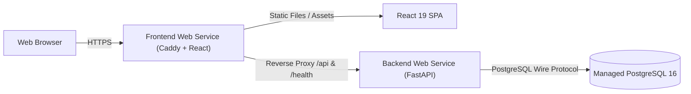

# Deploying Personal Lifecycle Tracker to Render

[Render](https://render.com) is a modern cloud Application Platform-as-a-Service (PaaS). The Personal Lifecycle Tracker infrastructure supports two independent environments:
1. **Development (`dev`)**: Free tier services (`personal-lifecycle-*-dev`) managed via `render.yaml` or `terraform/render/`.
2. **Production (`production`)**: Independent copy with production tier services (`personal-lifecycle-*-prod`) managed via `render.prod.yaml` or `terraform/render-prod/`.

---

## Architecture on Render



- **Frontend**: Docker Web Service running Caddy 2 (`caddy:2-alpine`), serving the React 19 production build and reverse-proxying `/api/*` and `/health` requests to the backend service.
- **Backend**: Docker Web Service running FastAPI & Uvicorn (`python:3.11-slim`), connected to the managed PostgreSQL database.
- **Database**: Render Managed PostgreSQL (version 16), automatically provisioned and managed.

---

## Option A: 1-Click Render Blueprint

### 1. Development Environment (`render.yaml`)
To deploy the **dev** environment:
1. Connect your repository to Render Blueprints.
2. Render uses [`render.yaml`](../../render.yaml) by default.
3. Provisions:
   - `personal-lifecycle-db-dev` (Database: `lifecycle_dev`, Plan: `free`)
   - `personal-lifecycle-backend-dev` (FastAPI Web Service, Plan: `free`)
   - `personal-lifecycle-frontend-dev` (Caddy Web Service, Plan: `free`)
4. Click **Apply**.

### 2. Production Environment Copy (`render.prod.yaml`)
To deploy the independent **production** environment:
1. In the Render Dashboard, create a new Blueprint instance.
2. Point the Blueprint configuration to [`render.prod.yaml`](../../render.prod.yaml).
3. Provisions:
   - `personal-lifecycle-db-prod` (Database: `lifecycle`, Plan: `starter`)
   - `personal-lifecycle-backend-prod` (FastAPI Web Service, Plan: `starter`)
   - `personal-lifecycle-frontend-prod` (Caddy Web Service, Plan: `starter`)
4. Click **Apply**.

---

## Option B: Deploying via Terraform

### 1. Development Environment (`terraform/render/`)
```bash
# Validate Dev configuration
make tf-validate-render

# Plan Dev infrastructure
make tf-plan-render

# Apply Dev infrastructure
docker run --rm -it \
  -v $(PWD)/terraform/render:/workspace \
  -w /workspace \
  -e RENDER_API_KEY="rnd_your_api_key" \
  hashicorp/terraform:1.7.5 apply -var-file=terraform.tfvars.dev
```

### 2. Production Environment Copy (`terraform/render-prod/`)
```bash
# Validate Production configuration
make tf-validate-render-prod

# Plan Production infrastructure
make tf-plan-render-prod

# Apply Production infrastructure
docker run --rm -it \
  -v $(PWD)/terraform/render-prod:/workspace \
  -w /workspace \
  -e RENDER_API_KEY="rnd_your_api_key" \
  hashicorp/terraform:1.7.5 apply -var-file=terraform.tfvars.prod
```

### Environment Outputs
Both modules export identical output attributes:
- `backend_url`: URL for the backend API service.
- `frontend_url`: URL for the frontend application.
- `application_health_url`: Public healthcheck endpoint via Caddy reverse proxy (`/health`).
- `database_id`: Render managed PostgreSQL identifier.

---

## Option C: GitHub Actions CI/CD (`.github/workflows/ci.yml`)

The GitHub Actions workflow deploys automatically based on branch or workflow dispatch:
- **Pushes to `dev` / `develop`**: Deploys to the Dev environment and polls the configured Dev health URL (`RENDER_HEALTH_URL` or `https://<dev-service>.onrender.com/health`).
- **Pushes to `main`**: Deploys to the Production copy and polls the configured Production health URL (`RENDER_HEALTH_URL` or `https://<prod-service>.onrender.com/health`).
- **Manual Trigger**: Select `target_environment: production` or `target_environment: dev`.

See the [CI/CD Pipeline Guide](ci-cd.md) for secrets configuration.
